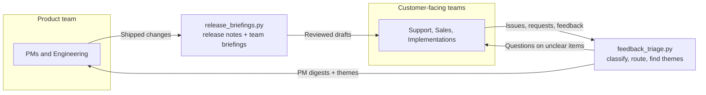

# Product Ops Launch & Feedback Loop

**A cross-team process design, plus the Claude workflows that run it.**

> **Concept project.** I designed this to show how I'd connect a product team with its customer-success teams and automate the busywork with AI. It isn't documentation from a real employer. The company "Brightline," its customers and all sample data are fictional.

**Author:** Francesca Djoufack · [github.com/FrannyBrave](https://github.com/FrannyBrave)

---

## The problem

As a B2B software company grows, two gaps open up:

- **Product → customer-facing teams:** Support, Sales and Implementations learn about changes late and aren't ready to configure, train or answer questions.
- **Customer-facing teams → product:** customer issues and requests get scattered across Slack, tickets and calls, reach the wrong PM, and the person who raised them never hears back.

This repo closes both gaps with **one launch path out, one intake path in,** and two Claude workflows that keep information moving without adding meetings.



## What's in the repo

| Path | What it is |
|---|---|
| [`process/launch-and-feedback-loop.md`](process/launch-and-feedback-loop.md) | **The process design.** Launch tiers, stages, owners, templates, intake and routing, closing the loop, guardrails, success metrics, and how to roll the process out |
| [`workflows/release_briefings.py`](workflows/release_briefings.py) | Turns a list of shipped changes into customer release notes plus briefings for Support, Sales and Implementations |
| [`workflows/feedback_triage.py`](workflows/feedback_triage.py) | Classifies customer feedback, routes each item to the right PM, finds recurring themes across customers, and drafts follow-up questions for unclear items |
| [`sample_data/`](sample_data/) | Fictional shipped changes and feedback for a lending-software company |
| [`config/routing.json`](config/routing.json) | Routing table: product area → owning PM |
| [`tests/`](tests/) | Offline tests that check rendering and the safety checks (no API key needed) |

## How the workflows stay trustworthy

| Principle | How it's built in |
|---|---|
| **Flag, don't guess** | Claude only uses facts from the input. Missing information goes to a "needs info" list with a specific question for the PM. Unclear feedback gets a question back to the submitter instead of a guessed product area. |
| **People decide** | Every output is marked DRAFT for review before anything reaches a customer. |
| **Structured output** | Claude answers through a required tool with a strict schema, so results always come back as valid, predictable data instead of free text that might not parse. |
| **Rules stay in code** | Claude classifies and writes. The script does the routing (always following the routing table) and counts customers per theme exactly. |
| **Automatic checks** | The script flags unknown IDs, changes missing from the output, and internal-only changes that slipped into customer notes. |
| **Emergencies skip the queue** | Production outages are flagged **ESCALATE NOW** for the support escalation path, not left in a weekly digest. |

## Run it yourself

You need Python 3.9+ and a Claude API key from [console.anthropic.com](https://console.anthropic.com).

```bash
pip install -r requirements.txt
export ANTHROPIC_API_KEY="your-key-here"     # Windows PowerShell: $env:ANTHROPIC_API_KEY="your-key-here"

# Product → customer-facing teams
python workflows/release_briefings.py --input sample_data/shipped_changes.json --out examples/release

# Customer-facing teams → product
python workflows/feedback_triage.py --input sample_data/feedback.csv --routing config/routing.json --out examples/triage
```

Outputs are written as Markdown files to `examples/`.

**Without an API key:**

```bash
python workflows/release_briefings.py --input sample_data/shipped_changes.json --dry-run   # shows the exact prompt
python tests/test_render.py                                                                # runs the offline tests
```

## Sample results

These are real outputs from running both workflows with Claude on the fictional sample data. Each file is marked DRAFT, the way a person would receive it for review.

| Workflow | Output |
|---|---|
| Release briefings | [Customer release notes](examples/release/customer-release-notes.md) · [Support](examples/release/support-briefing.md) · [Sales](examples/release/sales-briefing.md) · [Implementations](examples/release/implementations-briefing.md) · [Needs info](examples/release/needs-info.md) |
| Feedback triage | [Triage table](examples/triage/triage-table.md) · [PM digests](examples/triage/pm-digests.md) · [Themes](examples/triage/themes.md) · [Follow-ups](examples/triage/follow-ups.md) |

Things worth noticing:
- Instead of guessing, Claude flagged missing details with specific questions for the PM, including whether a reporting fix also corrects past months' reports.
- Summit Home Loans raised the Encompass request twice through two different teams. Because the script counts customers itself, the theme correctly shows **one** customer.
- The portal login outage was flagged **ESCALATE NOW** instead of waiting in a digest.

## What the sample data is designed to test

- **BL-421** (phone-camera upload) is missing who it affects and whether it needs configuration, so it should land in "needs info," not be guessed.
- **BL-433** is internal-only, so it should not appear in customer release notes.
- Three different customers report **slow pipeline date filters**, so they should be grouped as one theme.
- **FB-105** (portal login outage) should be flagged for immediate escalation.
- **FB-106** and **FB-110** are too vague to route, so they should get follow-up questions.

## What I'd build next

- Connect directly to Linear, Zendesk and Slack APIs, replacing the JSON and CSV files.
- Post release briefings to a Slack channel and Notion page automatically after PM approval.
- Send status updates back to requesters automatically when a PM marks an item planned, not now or shipped.
- Track the process metrics (on-time briefings, time to PM acknowledgment, share of requesters who hear back) on a small dashboard.
